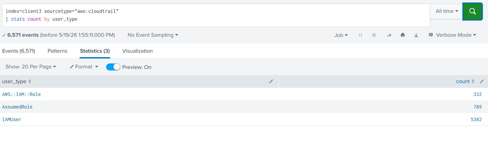
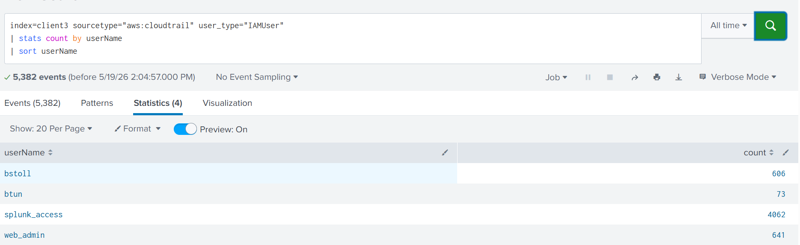
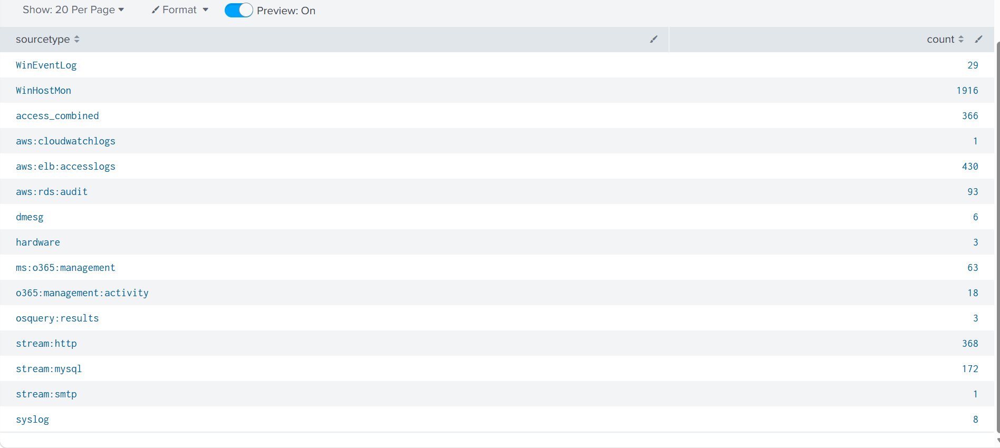
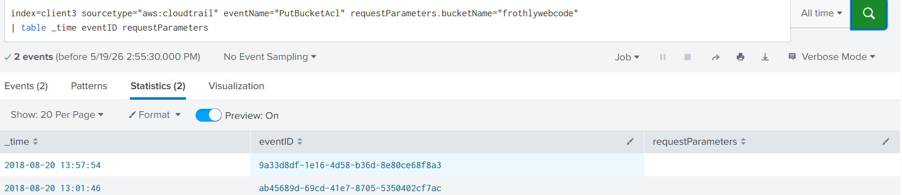
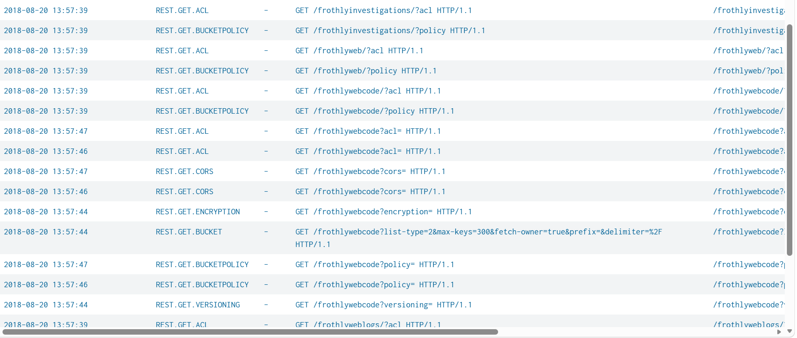
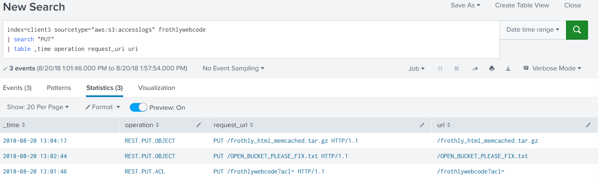
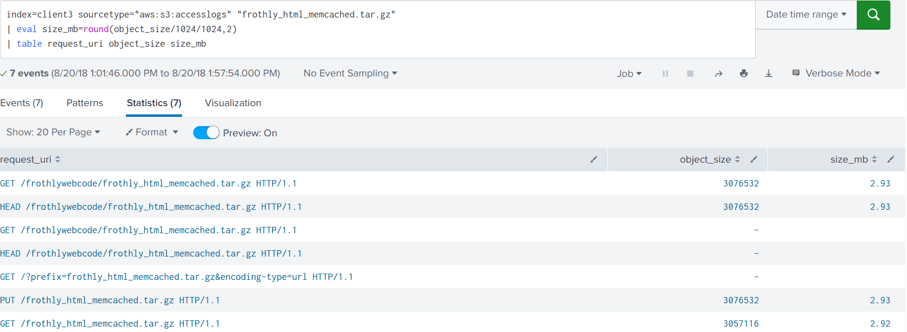
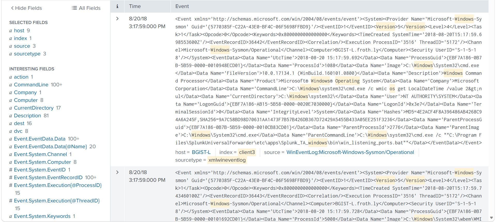

# 03 — AWS CloudTrail and S3 Activity Review

**Training dataset | Splunk investigation notes | AWS CloudTrail and S3 access logs**

## What I was looking at

I used Splunk to explore AWS identity events, bucket permissions, and object access in a historical training dataset. The searches also included a check of available log sources and Windows host telemetry.

This is a **log review**, not a confirmed security incident. The screenshots show activity in a dataset dated **August 20, 2018**; the search interface shows the queries being run in **May 2026**.

## Splunk searches and what they showed

### 1. Identify the types of AWS accounts in the logs

```spl
index=client3 sourcetype="aws:cloudtrail"
| stats count by user_type
```

The search returned 6,571 events overall. Among the events with the displayed `user_type` values, there were **5,382 IAMUser**, **789 AssumedRole**, and **332 AWS::IAM::Role** events. These three groups do not add up to the overall event count, so I would not assume they cover every event.



I then broke down the IAMUser results by username. That search returned **5,382 events** across four named identities in the training data.



**What this tells me:** The dataset has activity from multiple identity types and individual users. High event volume alone does not establish misuse.

### 2. Inspect available log sources

The Splunk sourcetype summary included Windows event logs, WinHostMon, AWS CloudWatch and load balancer logs, RDS auditing, Microsoft 365 management activity, HTTP and MySQL network streams, and osquery.



I also used the `hardware` sourcetype to look at three hosts and their reported CPU and memory fields. This was a quick environment inventory, not evidence of compromise.

### 3. Review AWS S3 bucket-permission activity

```spl
index=client3 sourcetype="aws:cloudtrail" eventName="PutBucketAcl" requestParameters.bucketName="frothlywebcode"
| table _time eventID requestParameters
```

The broad search showed **two matching events**, with timestamps of **13:01:46** and **13:57:54** on August 20, 2018. Restricting the search to the narrower interval in the screenshots returned **one** of those events.



**What this tells me:** There were bucket ACL-related API calls worth examining further. The screenshots do not show enough policy detail to conclude what permissions changed or whether the change was unauthorized.

### 4. Correlate S3 object operations

A search of the S3 access logs showed three PUT-related operations around **13:01–13:04**, including an ACL-related request and two object uploads. One query for the `frothly_html_memcached.tar.gz` archive returned **seven matching log entries** involving PUT, GET, and HEAD requests. The reported object size on populated rows was approximately **2.93 MB**.







Earlier filters returned zero results, which underscores the importance of checking the time range, fields, and search syntax before treating an empty result as meaningful.

**What this tells me:** The logs indicate changes and access to S3 resources. They do **not** by themselves establish malicious intent, the contents of the archive, or confirmed data exfiltration.

### 5. Check Windows host telemetry

The final screenshots show Windows process monitoring and Sysmon events, including command-line fields in XML event data.

 These are useful sources for host-level investigation, but the screenshots do not establish that any specific Windows process caused the AWS S3 events.

## Investigation outcome

**Disposition: Inconclusive / requires further validation.** There is enough activity to justify a closer review of the bucket ACL changes and object accesses, but the provided screenshots do not establish a confirmed security incident.

If I were continuing the investigation, I would:

- Inspect the full before-and-after bucket ACL settings and the identities responsible for the changes.
- Check the IAM roles, policies, and source addresses associated with the observed calls.
- Correlate S3 requests against CloudTrail details and any authorized change or test activity.
- Establish whether the archive contained sensitive data and whether access was expected.
- Validate any host-level links using timestamps and matching identities rather than assuming the Windows and AWS events are connected.

## Evidence note

The screenshots in this case study are taken from the authorized training exercise. The [full screenshot gallery](../docs/aws-cloudtrail-s3-screenshot-gallery.md) includes all 16 images, including searches that returned no results. These observations do **not** establish a confirmed breach, privilege escalation, or data theft.

*Completed as part of an authorized cybersecurity training exercise using historical datasets.*
